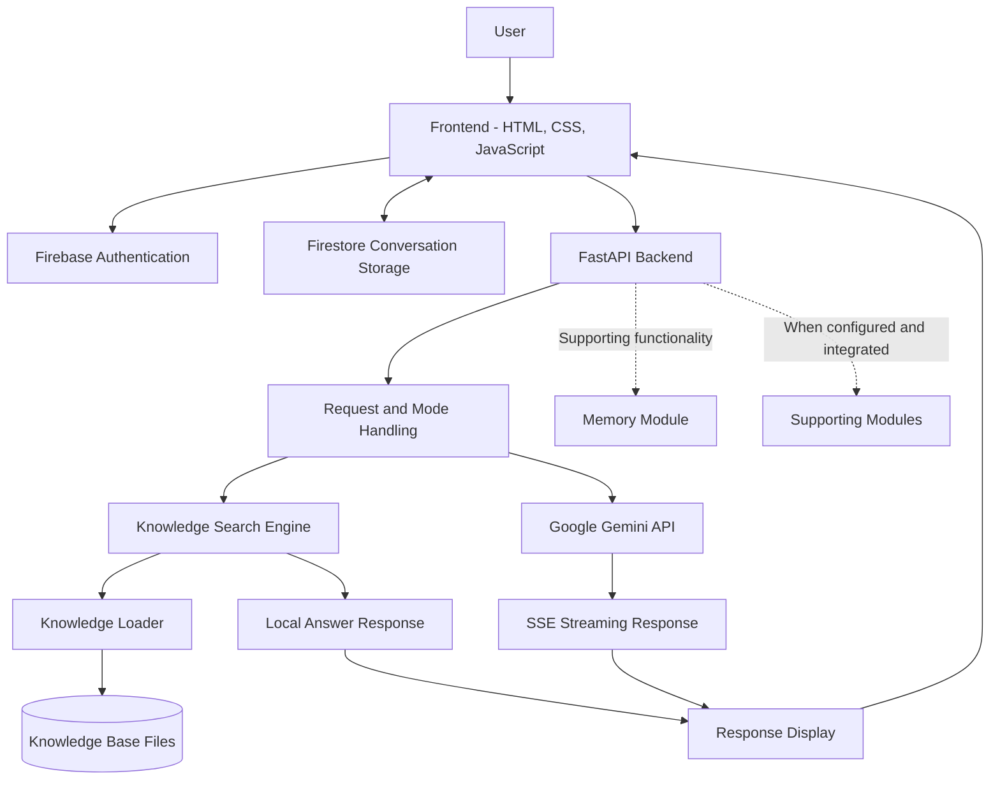
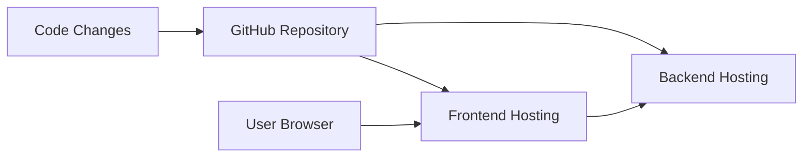

## System Architecture

Personal AI v2 follows a modular client-server architecture. The frontend provides the user interface, the FastAPI backend processes requests, and the knowledge-search system retrieves relevant information. Online AI integration and supporting modules provide additional capabilities.

### 1. High-Level Architecture

### 2. Frontend Layer

**Location:** `frontend/index.html`

The frontend is responsible for user interaction and displaying responses.

Responsibilities:
- Provide the chat interface.
- Accept user questions and send requests to the backend.
- Display local answers and online AI responses.
- Handle normal JSON responses and Server-Sent Events (SSE) streaming.
- Provide controls for stopping response generation.
- Integrate authentication and conversation persistence.
- Communicate with the backend API.

### 3. Backend API Layer

**Location:** `api/main.py`

The backend acts as the communication layer between the frontend and the assistant's processing components.

Responsibilities:
- Receive chat requests.
- Process the requested response mode.
- Invoke knowledge search for local responses.
- Use online AI integration when the selected mode or fallback logic requires it.
- Return normal JSON responses for applicable local paths.
- Return streaming responses for applicable online AI paths.
- Handle API errors and response metadata.

**Backend framework:** FastAPI.

### 4. Knowledge Search Layer

**Location:** `core/search.py`

The knowledge-search engine retrieves information relevant to the user's question.

Responsibilities:
- Normalize query terms.
- Compare user queries with available knowledge topics.
- Rank candidate results using the implemented search-scoring logic.
- Identify relevant topics from the knowledge base.
- Provide search results and scores to the request-handling layer.

The search engine depends on the available knowledge content. Search quality can vary according to topic coverage, terminology, and relevance scoring.

### 5. Knowledge Loading Layer

**Location:** `core/loader.py`

The knowledge loader makes structured knowledge content available to the search system.

Responsibilities:
- Load supported knowledge files.
- Extract available topic information.
- Prepare content for searching.
- Provide loaded knowledge to the search component.

**Knowledge directory:** `knowledge/`

The knowledge directory contains structured topic files used by the offline search system.

### 6. Online AI Integration

**Integration:** Google Gemini API

The online AI integration provides a separate response path when configured and invoked by the backend.

Responsibilities:
- Send supported requests to the configured online AI service.
- Receive generated responses.
- Stream response content where supported by the backend.
- Handle unavailable services, API errors, and quota limitations.

Online responses depend on valid API credentials, available quota, network connectivity, and correct backend configuration.

### 7. Conversation and Memory Layer

**Related components:** Frontend Firebase integration and memory-related modules.

The project includes components intended to support conversation persistence and memory.

Responsibilities may include:
- Associating conversations with authenticated users.
- Storing and retrieving conversation history.
- Keeping messages associated with their conversations.
- Managing memory information.

The exact behavior depends on the active frontend implementation, Firebase configuration, database rules, and integration of the memory modules. Persistence should be verified through actual sign-in, refresh, and restore tests.

### 8. Supporting Modules

The repository also contains supporting modules for additional capabilities.

| Module | Intended responsibility |
|---|---|
| `ai_api.py` | AI API integration utilities |
| `calculator.py` | Calculation-related functionality |
| `github.py` | GitHub-related operations |
| `live_data.py` | Live data retrieval |
| `memory.py` | Memory-related functionality |
| `online_search.py` | Online search functionality |
| `model.py` | Neural-network model definition |
| `train.py` | Model training |
| `nltk_utils.py` | Natural-language processing utilities |

These modules should only be considered part of the live web request path where they are actually imported and invoked.

### 9. Neural-Network Components

**Related files:** `model.py`, `train.py`, and `nltk_utils.py`

The repository contains a PyTorch-based neural-network implementation and supporting training utilities.

This is separate from the BM25-style keyword/fuzzy knowledge-search engine used by the web API. The neural-network components should not be described as powering live website answers unless they are explicitly connected to the active backend.

### 10. Deployment Architecture

The project uses GitHub for source-code management.

- **GitHub:** Stores project source files.
- **Backend hosting:** Runs the FastAPI application using the configured startup command.
- **Frontend hosting:** Serves the web interface.
- **Browser:** Communicates with the frontend and backend.

The frontend and backend may require separate deployment processes. A GitHub commit does not guarantee that both services have deployed successfully.

### 11. Request Processing Workflow

1. The user enters a question in the web interface.
2. The frontend sends a request to the backend API.
3. The backend determines the applicable response mode.
4. The knowledge-search component searches the available local knowledge base when applicable.
5. If a suitable local result is available, the backend can return a local response.
6. If the selected mode or fallback logic requires online AI, the backend attempts to obtain a response from the configured Gemini service.
7. The backend returns JSON or an SSE stream, depending on the response path.
8. The frontend displays the answer.
9. Conversation persistence is handled by the configured storage integration.

### 12. Main Design Goals

- Modular and maintainable architecture.
- Knowledge-based question answering.
- Offline search capabilities.
- Optional online AI integration.
- Separation of frontend and backend responsibilities.
- Extensibility for additional tools and features.
- Improved conversation management and response reliability.
